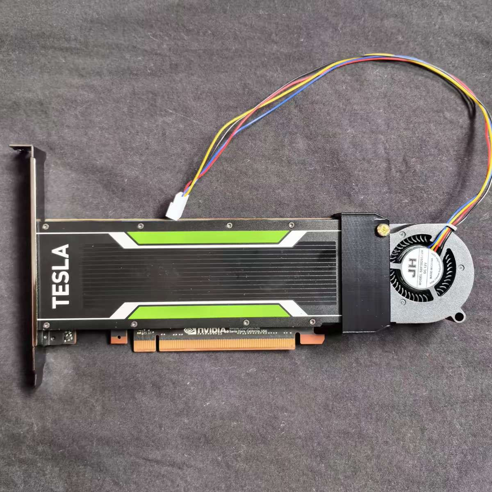
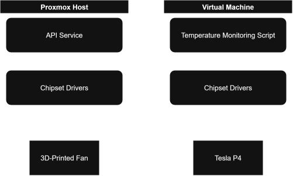

# A Fan for a GPU the Host Can't See

*Xingjian Yuan (Peler) · Homelab engineering notes*

*The Tesla P4 with its 3D-printed shroud and 40 mm fan, the passive card this post is about.*

A Tesla P4 is a datacenter card. It is built to sit in a server chassis with a wall of airflow pushing across it, so it ships with a heatsink and no fan. I bought one for my homelab, put a 3D-printed fan on it, and then ran into a problem that had nothing to do with the fan: the machine that owns the fan cannot read the temperature of the card it is supposed to cool.

This post is about how I solved that. The short version is a small API on the Proxmox host and a polling script inside a virtual machine. The longer version is about why the obvious alternatives did not work, and why I spent more time on the failure behaviour than on the happy path.

*The monitoring script in the VM reads the GPU and calls the API service on the Proxmox host. The host reaches the fan through the chipset's PWM control. The GPU temperature never crosses to the host; only a speed request does.*

## Why a datacenter card at all

I wanted a Tesla compute card of my own, and the P4 was cheap. It also fits what the server does. It draws 75 W, it is physically small, and it can decode and encode video in real time. My NAS-side media services need exactly that when someone is streaming a film, and hardware transcoding keeps the CPU almost idle while it happens.

The catch is the one that comes with the product category: no active cooling.

## The card cooks itself

Without a fan, the card sat around 70 °C or higher at idle. Under load it climbed to 90 °C and beyond, at which point it either throttled hard or stopped working. Idle at 70 °C was the useful number. It told me this was not a tuning problem, and that the card needed airflow of its own.

The mechanical fix was simple. I modelled a shroud in Fusion that holds a 40 mm fan against the heatsink, printed it in PLA, and went through two revisions to get it right. That solved cooling. It did not solve control.

## The real problem: the temperature lives on the other side of the wall

A fixed-speed fan would have worked, but it would have been the wrong answer. The load on this card is very uneven. When it is idle I want the fan nearly silent. When it has been transcoding for hours I want real airflow, and I want the fan to follow the card, not run flat out all day.

The difficulty is that I pass the P4 through to a virtual machine. Passthrough hands the whole PCI device to the guest. That is what I want for performance, because it removes the virtualisation layer between the VM and the card. It also means the Proxmox host loses visibility. `nvidia-smi` is unusable on the host, because the card is no longer the host's device.

The fan, meanwhile, is plugged into the host. So the sensor is inside the VM, the actuator is outside it, and neither side can see the other.

## Three ways out

| Option | Why I did or didn't take it |
|---|---|
| **Follow CPU temperature** | During transcoding the CPU sits at about 10% load and has a large tower cooler, so its fan stays low and steady. The GPU is the part that heats up, and CPU temperature says almost nothing about it. |
| **Share the GPU with vGPU** | The P4 is an old card and I was not confident about support for it. It would also have meant giving up full passthrough. |
| **Decouple the two sides with an interface** | Chosen. |

The third option was also the one I found most interesting, which counted for something. It keeps passthrough intact, and it leaves me with finer control than a single-sensor setup would give.

## The design: one API, one script

The design has two halves that meet over the network.

**On the host.** The fan is plugged into a motherboard PWM header, and speed control goes through the kernel's driver for the board's chipset. I wrapped that in one script that can drive every fan I care about, not only this one but the chassis fans as well. A small Flask service sits on top of the script and exposes three operations:

- set a fan to a given percentage,
- set a fan to a given speed,
- restore the board's default fan control.

The service listens only on the internal network. The caller is a VM on the same host, and for a home lab I considered that restriction sufficient.

**In the VM.** A script polls the GPU's temperature about every ten seconds and maps it onto a temperature curve. It then asks the host API for the matching fan speed. Ten seconds is comfortable: the card's temperature does not change fast enough to need more, and polling that slowly costs almost nothing.

The interface is deliberately thin. The VM never learns how the fan is wired, which header it is on or what driver moves it. The host never learns anything about the GPU. The only thing that crosses the boundary is a speed request, and that is the only thing the two sides have to agree on.

## Failing loudly and safely

A control loop that spans two machines has more ways to break than a fan header does, so this is where I spent my design effort.

The API can go down, the script in the VM can die, or the VM can simply be shut down. All three end the same way: control falls back to the motherboard's own fan profile, and I set that profile to run at maximum speed. The failure mode is therefore very specific: the fan gets loud. If I am anywhere near the machine I can hear that something is wrong, and in the meantime the card cannot overheat.

A silent failure would be the dangerous kind here. A noisy one is just a prompt to go and look. I would defend this choice harder than any other in the design. Optimising for quiet in the working case is fine, but the failure case should always err on the side of cooling.

## Results

To test under real stress, I ran AI models on the card as a burn-in. Under that load the temperature held at around 60 °C. At idle it settles at roughly 40 °C.

The more convincing test was ordinary use. I have watched two films back to back, several hours of continuous transcoding, with the card working the whole time. There were no problems, and because the fan follows the temperature curve, it never became a noise issue while I was watching.

| Condition | Without a fan | With the controlled fan |
|---|---|---|
| Idle | 70 °C and above | Roughly 40 °C |
| Heavy load | 90 °C or higher, throttling or stopping | About 60 °C |
| Several hours of transcoding | Not viable | Stable, with controlled noise |

## What I would change

Nothing, at the moment. The approach is stable and does not depend on anything exotic. It also has a useful side effect: because every fan sits behind the same host API, I can control them individually and in more detail than the BIOS allows.

## Takeaways

Three decisions carry most of the weight in this design:

- **Keep passthrough and bridge the gap.** Passthrough is the reason the GPU is fast. I did not want to give it up, so I put one interface across the boundary instead.
- **Make the interface as small as possible.** The API accepts a speed. Neither side needs to understand the other, which is what makes each side easy to change.
- **Fail toward safety.** When the controller goes away, the fan goes to full speed.

The same idea connects my NAS VM to the machines that mount it: one VM does a job, and the others reach it over the network. Between VMs, and between a VM and its host, a small network API goes a long way.
