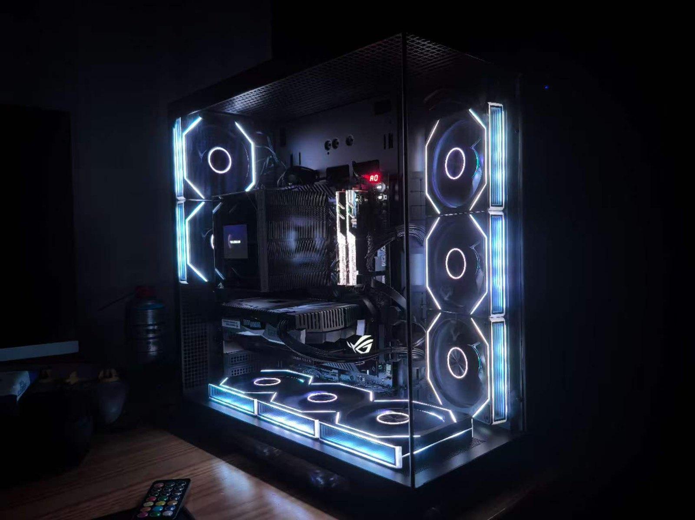
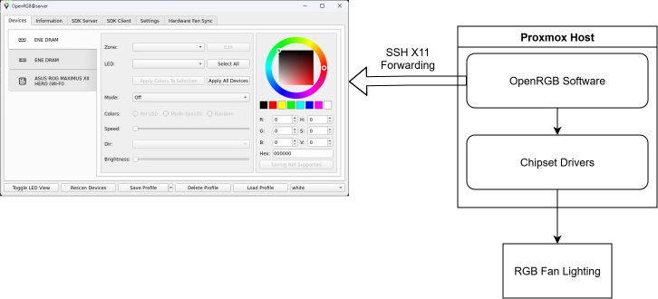

# Controlling Motherboard RGB on a Headless Proxmox Host with SSH X11 Forwarding

*Xingjian Yuan (Peler) · Homelab engineering notes*

*The finished homelab with the chassis lighting on, the lighting this post sets up control for.*

I wanted the inside of my homelab to look good, which on an ASUS ROG motherboard means RGB lighting. The software that controls it, OpenRGB, is a graphical program. My host runs Proxmox, and Proxmox has no desktop. A graphical program on a machine with no display has nowhere to draw its window.

This post is about how I got around that. The answer was SSH X11 forwarding: OpenRGB runs on the host, and its window appears on my Windows laptop. It turned out to be the lowest-friction option I found, and it is the one I still use.

*OpenRGB talks to the chipset drivers on the host to reach the RGB fan lighting. Only the window is forwarded to the laptop; the lighting hardware never leaves the host.*

## Why bother with lights

The simple reason is aesthetics. I want a homelab that looks good, and a lit interior behind tempered glass is something I enjoy showing people.

There is a longer-term reason too. RGB lighting is an output device I already own, wired into the machine. Once I can control it programmatically, I can make it respond to what the server is doing: load, events, state. That is a plan, not something running today, but it shaped the decisions below.

## Two obstacles

**A board that drivers don't like.** My motherboard is an ROG board, and many open-source drivers do not support it well. I went through several before finding a working path, and the build that runs now is one I compiled by hand.

**A host with no screen.** Proxmox ships without a desktop environment, which is what a hypervisor should do. But it means a graphical tool has to find some other way to reach a display.

## How X11 forwarding solves it

On Linux, a graphical program is an X11 *client*: it asks a display server to draw windows and deliver input. Normally the client and the display server are on the same machine. X11 forwarding separates them. SSH carries the X protocol over the same encrypted connection as the shell, so the client runs on the remote host while the display server runs on the machine in front of me.

In my case the display server is already there. My terminal on the laptop is MobaXterm, which includes its own X server. So nothing extra needed setting up on the laptop. I log in over SSH, start OpenRGB on the host, and its window shows up on my screen almost immediately.

I used this approach again afterwards, because it is the lowest-friction path I know of. There is no extra service to run on the host and no client to install separately.

## How it behaves day to day

| Aspect | Experience |
|---|---|
| **Persistence** | Settings are saved with OpenRGB's own profile feature. After a reboot, the lighting returns to the last saved state without any action from me. I can also load other colour profile files. |
| **Latency** | There is a delay between a click in the forwarded window and a change on the hardware. It is under a second, which is fine for something I adjust occasionally. |
| **Responsiveness** | I have not noticed any stutter in the forwarded interface. |
| **Security** | The forwarding runs inside an SSH session I already use, so I consider this the least worrying part of the setup. |

The honest limitation is that OpenRGB's built-in presets are few. I plan to expand them.

## The alternative I haven't taken yet

OpenRGB also has a server mode, where a separate client controls the lighting over the network. I did not use it, but I have not ruled it out. It is the natural route for what I eventually want: effects that respond to the host's state automatically, so a heavy transcoding job or a VM event could change the colour without me touching anything.

For a human adjusting colours, forwarding a GUI is simpler. For a machine adjusting colours, a server is the right shape. I expect to end up with both.

## Takeaways

- **Don't fight a missing display; borrow one.** The host stays lean, and the laptop provides the screen.
- **Pick the path with the least moving parts.** X11 forwarding needed nothing new on my side because my terminal already had an X server.
- **Choose the tool for the controller.** A GUI forwarded over SSH suits a person. A server mode suits automation. Which one you need depends on who, or what, is deciding the colour.
